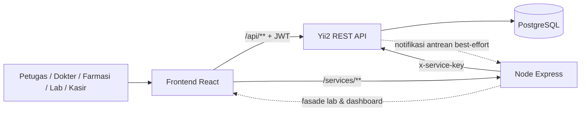
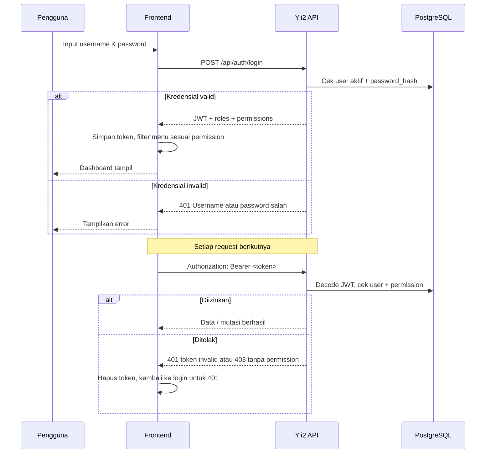
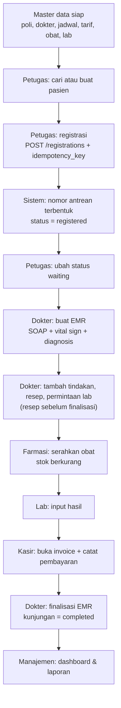
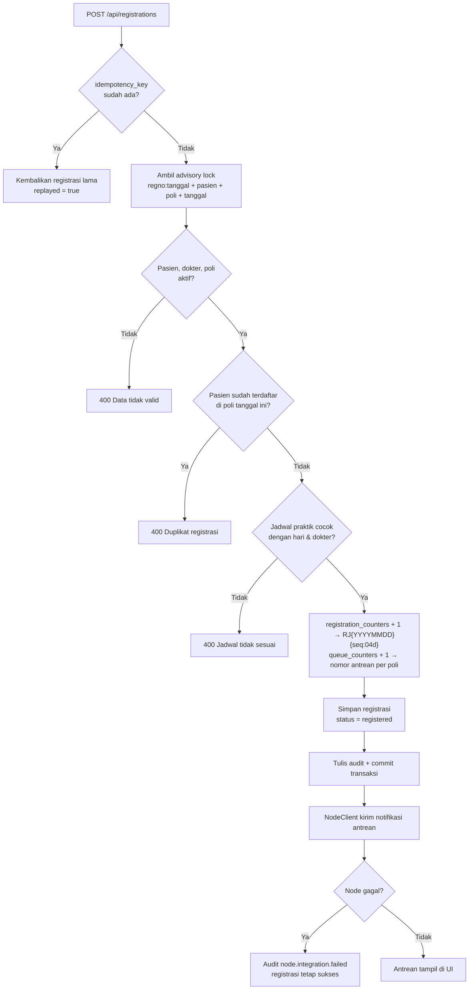
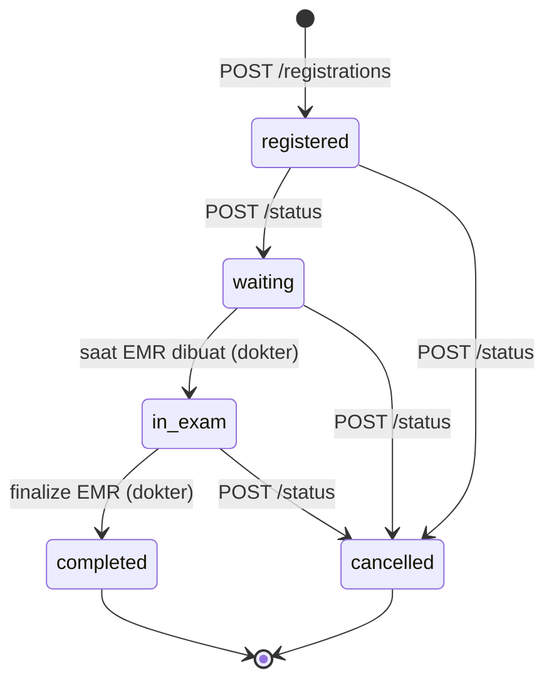
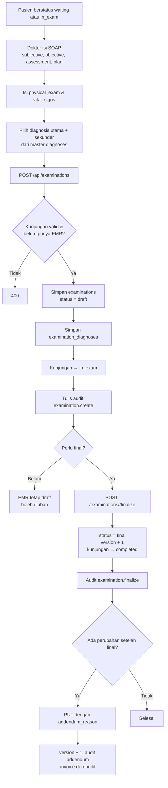
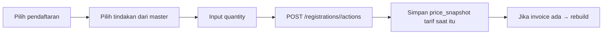
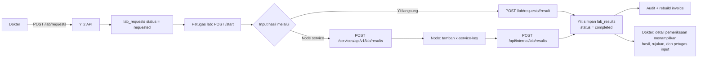
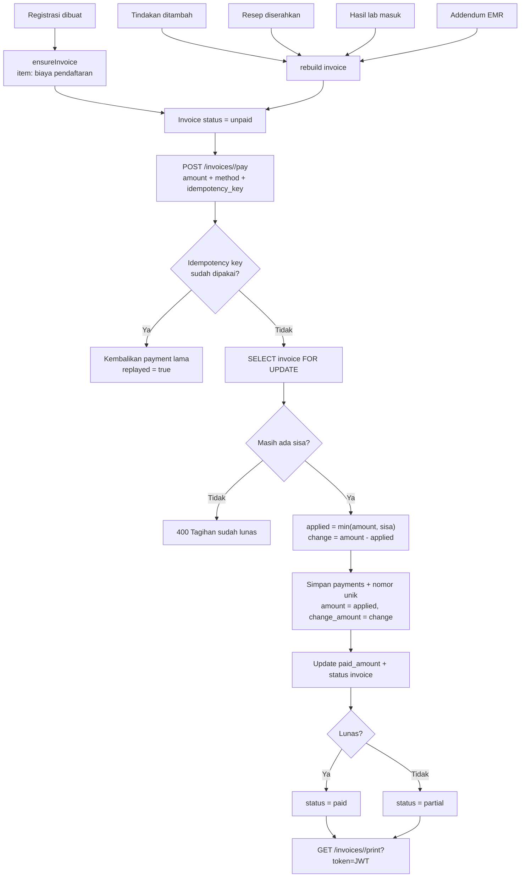
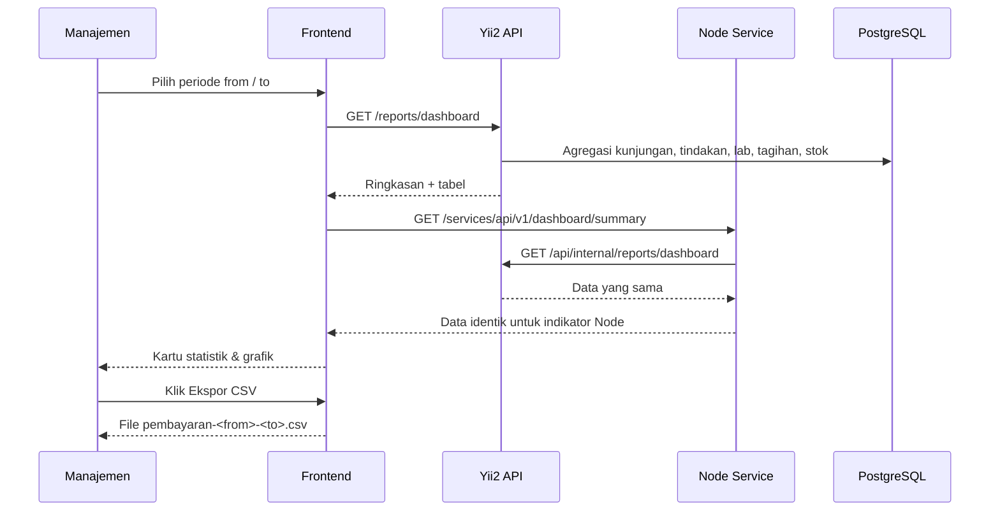

# Alur Proses SIMRS Rawat Jalan

Dokumen ini menjelaskan **alur pengguna dan alur teknis** sistem dari login hingga
laporan. Diagram menggunakan [Mermaid](https://mermaid.js.org/), sehingga bisa langsung
dilihat di GitHub, GitLab, atau editor Markdown yang mendukung Mermaid.

Untuk kontrak request/response lihat [`API.md`](API.md); untuk relasi tabel lihat
[`ERD.md`](ERD.md); untuk alasan desain lihat [`DECISIONS.md`](DECISIONS.md).

---

## 1. Peta alur keseluruhan



Prinsip utama: **Yii2 memegang semua transaksi klinis**. Node hanya meneruskan/aggregasi
data dan tidak pernah menulis langsung ke database.

---

## 2. Alur login dan otorisasi



---

## 3. Alur kunjungan lengkap (happy path)



> Invoice dapat dibuka lebih awal. Setiap perubahan tindakan/resep/lab/addendum
> memicu `rebuild()` otomatis, jadi total selalu diperbarui. Resep harus dibuat
> sebelum finalisasi; setelah `final`, tombol **Buat resep** hilang dan API menolak.

---

## 4. Alur pendaftaran dan antrean



> Notifikasi push FCM juga bersifat best-effort dan opsional. Tanpa konfigurasi Firebase,
> transaksi tetap sukses, audit `fcm.send` mencatat `sent: 0`, dan UI menyembunyikan opsi
> notifikasi saat login.

Endpoint terkait:

| Aksi | Endpoint |
| --- | --- |
| Daftar / cari registrasi | `GET /api/registrations` |
| Buat registrasi | `POST /api/registrations` |
| Lihat antrean hari ini | `GET /api/registrations/queue` |
| Ubah status | `POST /api/registrations/<id>/status` |
| Lihat tindakan kunjungan | `GET /api/registrations/<id>/actions` |

---

## 5. Transisi status kunjungan



Catatan:

- Membuat pemeriksaan otomatis mengubah kunjungan menjadi `in_exam` oleh dokter.
- Finalisasi EMR otomatis mengubah kunjungan menjadi `completed` oleh dokter.
- Endpoint `POST /registrations/<id>/status` hanya untuk `waiting`/`cancelled` (petugas);
  `in_exam` butuh `examination.create` dan `completed` ditolak `400`.
- Transisi selain di atas ditolak dengan `400 Transisi status tidak valid`; percobaan
  `in_exam` tanpa permission dokter ditolak `403`.

---

## 6. Alur pemeriksaan / EMR



---

## 7. Alur tindakan, resep, dan stok obat

### 7.1 Tindakan kunjungan



Harga master boleh berubah; tagihan lama tetap memakai `price_snapshot`.

### 7.2 Resep dan penyerahan obat

```mermaid
sequenceDiagram
  participant D as Dokter
  participant Y as Yii2 API
  participant DB as PostgreSQL
  participant F as Farmasi

  D->>Y: POST /prescriptions + items
  Y->>DB: Tolak jika examination.status = final
  Y->>DB: SELECT drug FOR UPDATE + cek available_stock<br/>= stock master - total resep pending
  Y->>DB: Simpan prescriptions + prescription_items<br/>price_snapshot diambil dari master
  Note over Y,DB: Stok fisik belum dikurangi; resep pending<br/>berlaku sebagai reservasi sementara
  Y-->>D: Resep status = pending

  D->>Y: Klik Buat resep lagi → GET /examinations/{id}
  Y-->>D: Item + catatan resep pending dimuat kembali
  D->>Y: PUT /prescriptions/{id} (perbarui)
  Y->>DB: Cek status pending + examination belum final
  Y-->>D: 200 Resep diperbarui (tanpa duplikat)

  F->>Y: POST /prescriptions/<id>/dispense
  Y->>DB: SELECT prescription FOR UPDATE
  Y->>DB: UPDATE drugs SET stock = stock - qty<br/>WHERE stock >= qty RETURNING stock
  alt Stok mencukupi
    Y->>DB: INSERT stock_movements reason = dispense
    Y->>DB: status = dispensed + audit
    Y->>DB: Rebuild invoice
    Y-->>F: 200 Obat diserahkan
  else Stok tidak mencukupi
    Y-->>F: 400, transaksi di-rollback
  end
```

> UI dokter memuat `/api/drugs` saat modal resep dibuka dan menyegarkannya setiap 10 detik.
> Field `available_stock` menjadi `max` pada input jumlah dan nilai yang diketik langsung
> dibatasi ke sisa jatah (termasuk sisa antar-baris obat yang sama). Saat **Simpan/Perbarui**,
> UI mengambil ulang `/api/drugs` sebelum mengirim payload; bila stok berubah dan jumlah tidak
> memenuhi, field terkait diberi highlight merah dan pesan peringatan, lalu request dibatalkan.
> Saat mengubah resep `pending`, jumlah yang sudah dipesan resep itu sendiri ditambahkan kembali
> agar tidak terhitung sebagai stok orang lain.

---

## 8. Alur laboratorium



Jalur Node tetap berakhir di Yii. Node hanya meneruskan `created_by`, `result`, dan
`reference_range`; validasi dan penyimpanan tetap dilakukan Yii.
`GET /api/examinations/<id>` menggabungkan `lab_requests` dengan `lab_results`, sehingga
dokter melihat hasil pada detail riwayat kunjungan tanpa membuka modul laboratorium.

---

## 9. Alur billing dan pembayaran



Status invoice: `unpaid` → `partial` → `paid`. Pembayaran dengan kunci yang sama
tidak pernah menambah `paid_amount` dua kali. Nominal yang melebihi sisa dicatat sebagai
`payments.change_amount` (kembalian), bukan ditolak; yang masuk `paid_amount` tetap maksimal
sisa tagihan.

---

## 10. Alur dashboard dan laporan



---

## 11. Peta peran, aksi, dan endpoint

| Peran | Aksi utama | Endpoint kunci |
| --- | --- | --- |
| `registration` | Buat pasien, daftarkan pasien, kelola antrean | `/patients`, `/registrations`, `/registrations/<id>/status` |
| `doctor` | Baca EMR, buat EMR, tindakan, resep & ubah resep sebelum final, minta lab | `/examinations`, `/prescriptions`, `/prescriptions/<id>` (PUT), `/lab/requests` |
| `nurse` | Lihat pasien & antrean, bantu EMR | `/patients`, `/registrations`, `/examinations` |
| `pharmacy` | Lihat/proses resep, pantau stok | `/prescriptions`, `/prescriptions/<id>/dispense`, `/drugs` |
| `laboratory` | Lihat request, mulai, input hasil | `/lab/requests`, `/lab/requests/<id>/result` |
| `cashier` | Lihat/buat invoice, catat pembayaran, laporan | `/invoices`, `/invoices/<id>/pay`, `/reports/*` |
| `management` | Dashboard, laporan | `/reports/*` |
| `admin` | Semua aksi + kelola master & pengguna | `/users`, master, dan seluruh endpoint |

Filter menu di frontend memakai `user.permissions` dari response login; backend tetap
mengvalidasi permission dengan `requirePermission()` pada setiap endpoint. Tagihan hanya
untuk `admin`/`kasir` (`billing.view`); menu Data master hanya untuk `admin`
(`master.manage` di `frontend/src/App.jsx:32`), sedangkan `master.view` tetap dipakai
sebagai permission baca untuk lookup seperti `/drugs` pada Farmasi.

---

## 12. Checklist menjalankan alur demo

Gunakan akun demo `admin / Admin123!` (atau akun peran sesuai tabel di atas).

1. Buka `Data master` → pastikan poliklinik/unit pelayanan, dokter, jadwal, tindakan, obat, diagnosis,
   dan jenis lab tersedia.
2. `Pasien` → Tambah pasien → catat No. RM.
3. `Pendaftaran` → pilih pasien, poli, dokter, tanggal → Daftarkan → catat nomor antrean.
4. `Pendaftaran` → ubah status menjadi `waiting`.
5. `Pemeriksaan` → klik **Isi EMR** → isi SOAP, vital sign, diagnosis → Simpan.
6. `Tindakan` → pilih pendaftaran → tambah tindakan.
7. `Pemeriksaan` → **Buat resep** pada pemeriksaan pasien (dokter) → `Farmasi` → klik
   **Serahkan** pada antrian resep.
8. `Laboratorium` → buat permintaan → **Mulai** → **Input hasil** (boleh via Node).
9. `Tagihan` → Buka tagihan → Detail → Catat pembayaran → Cetak.
10. `Pemeriksaan` → Finalisasi EMR. Resep wajib dibuat sebelum langkah ini; setelah
    final, tombol **Buat resep** disembunyikan dan API menolak pembuatan/perubahan resep.
11. `Dashboard` / `Laporan` → pilih periode → verifikasi angka → Ekspor CSV.

Untuk versi otomatis dari checklist ini, jalankan:

```bash
bash scripts/smoke.sh http://127.0.0.1:8086/api
```
